# Endpoint flows

What each endpoint does, from the client to the database and back. The diagrams follow the code: `internal/api/handlers.go`, `internal/api/health.go`, `internal/gql/`, `internal/items/store.go`, `internal/outbox/` and `internal/worker/`.

Every request goes through the same chain in each pod:

```
Client ─► Kubernetes Service (NodePort) ─► a ready pod ─► TraceRequests ─► LogRequests ─► router ─► RateLimit ─► handler/resolver ─► items.Store ─► Postgres
```

- **Service**: kube-proxy picks one pod that passes `/readyz`. importer-api is on NodePort `30080`, importer-graphql on `30082`.
- **TraceRequests**: opens an OpenTelemetry span named after the route (`GET /api/items/{id}`). Probes are skipped.
- **LogRequests**: one log line per request, with its status and `trace_id`. Probes are skipped.
- **RateLimit**: only on `/api/items*`, `/graphql` and `POST /`. Counts the request for the client's IP in Redis (`ratelimit:<service>:<ip>`, a fixed window). Over the limit, it answers `429` with `Retry-After` and the handler never runs. If Redis doesn't answer, the request goes through. The diagrams below leave this step out.
- **items.Store**: the only code that talks to Postgres, through a `pgxpool` pool. Both services and the worker use it.

Store errors other than "not found" are logged with the trace and returned as a bare `internal error`, so database details don't leak to clients.

## importer-api (REST)

### GET /

Shows which pod answered. No dependencies.

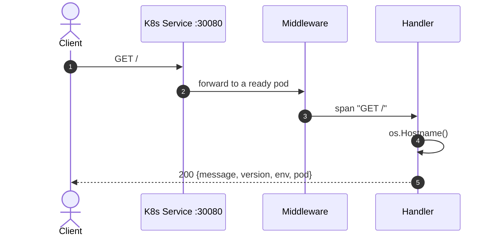

### GET /healthz

Liveness. Only checks that the process answers, so it never touches a dependency.

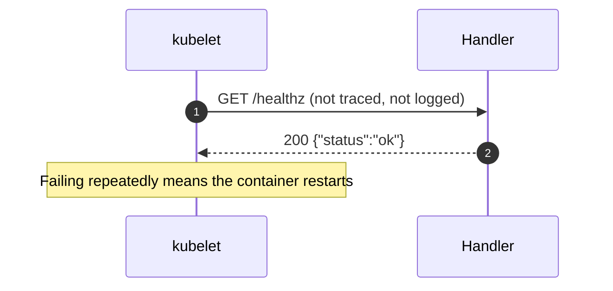

### GET /readyz

Readiness. Pings every configured dependency at the same time, within 2s.

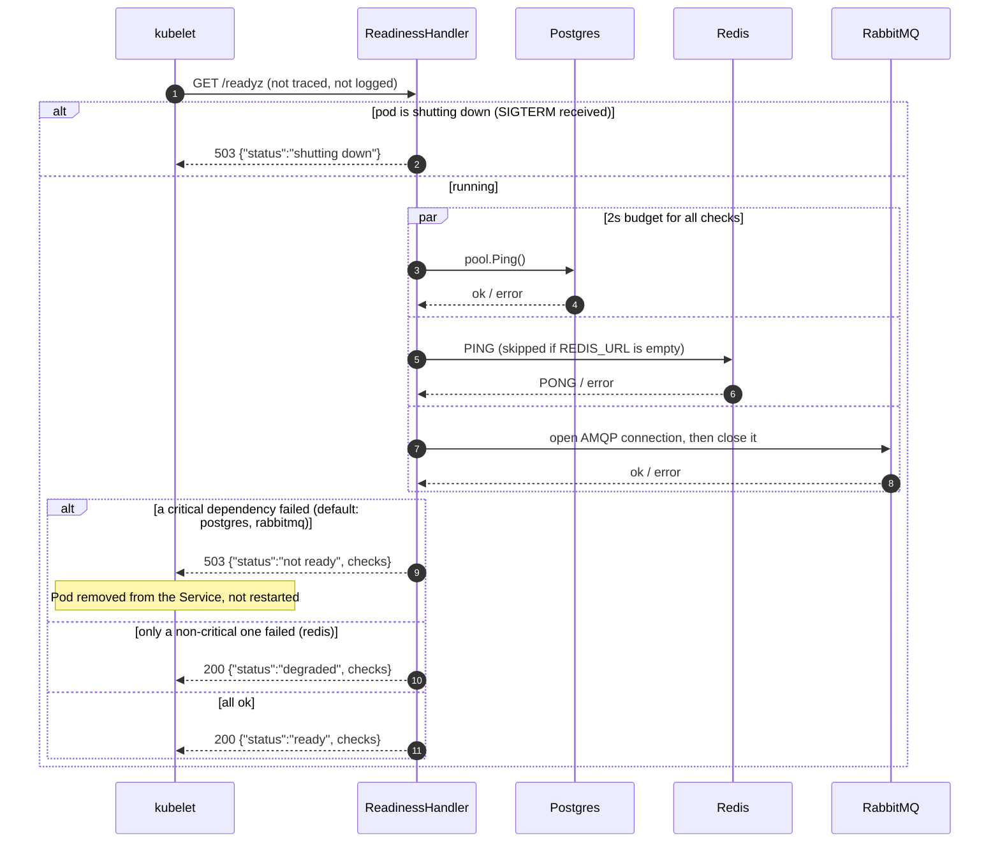

### GET /api/items

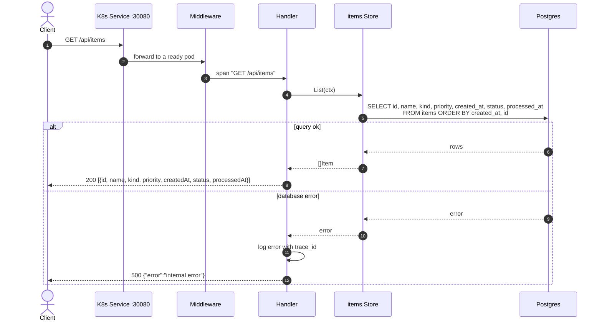

### GET /api/items/{id}

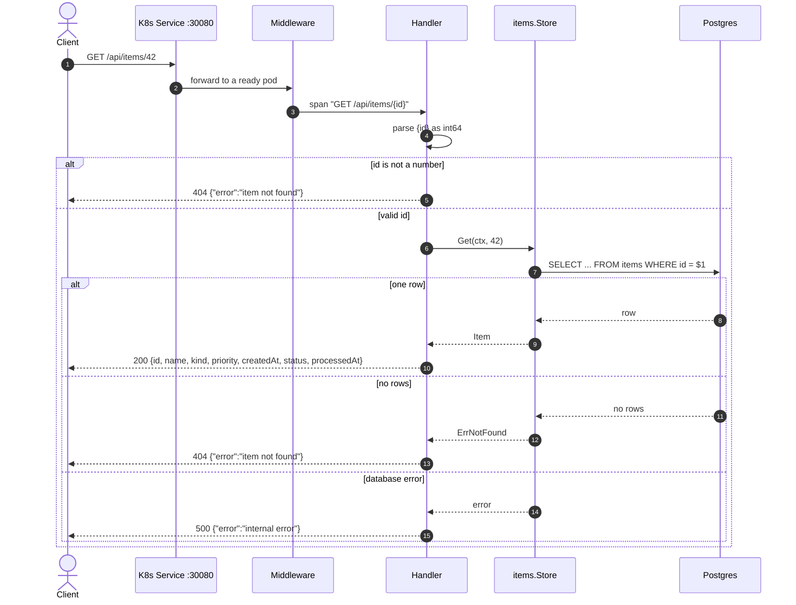

### POST /api/items

The request itself only writes to Postgres: the item and its `item.created` event, in one transaction. Publishing to RabbitMQ and processing happen afterwards, in the background.

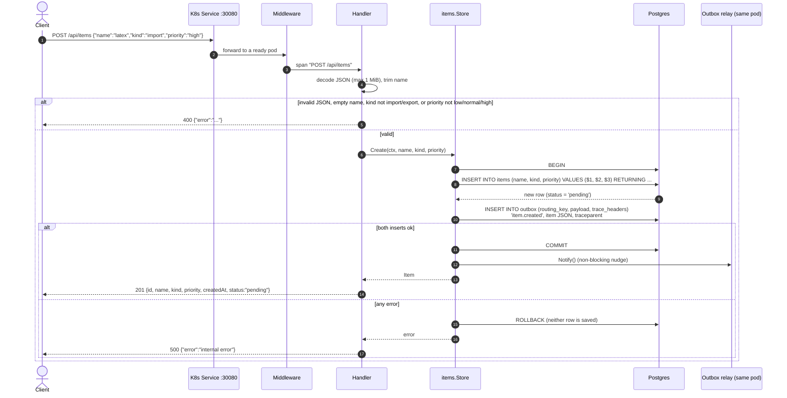

Then, asynchronously:

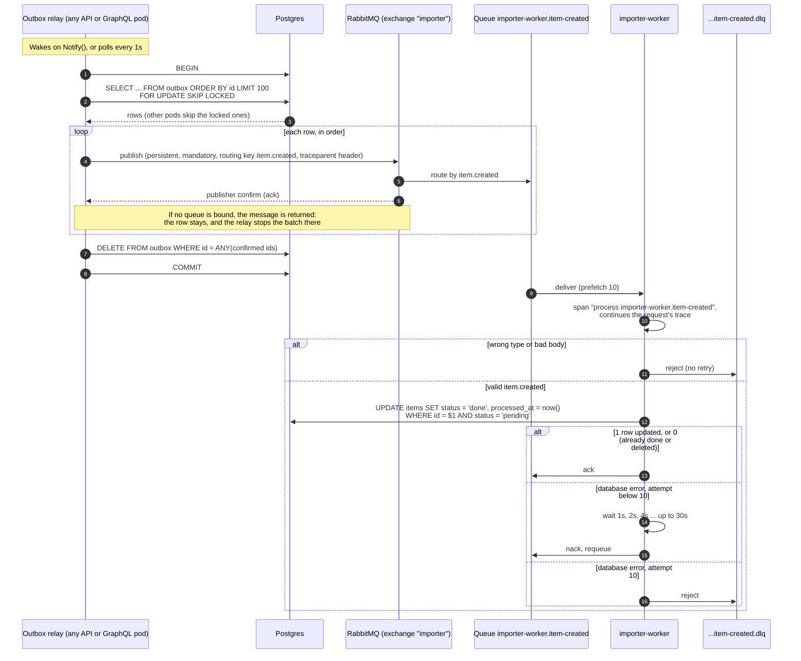

Delivery is at least once: if a pod dies after RabbitMQ confirms but before the `DELETE` commits, the event is published again. The `AND status = 'pending'` condition makes the duplicate harmless.

### DELETE /api/items/{id}

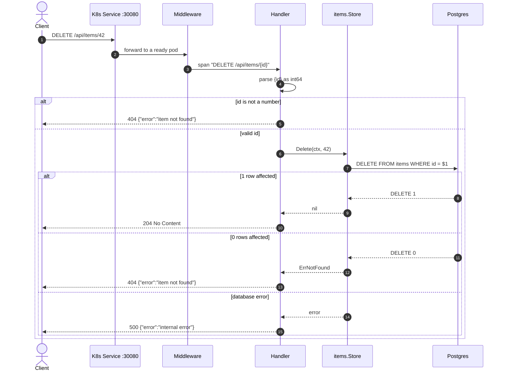

No event is published. If the item was still pending, the worker's `UPDATE` later matches no row and the message is acked.

## importer-graphql

`/healthz` and `/readyz` work the same as in importer-api: `/readyz` uses the same `ReadinessHandler` and checks.

### GET / (GraphiQL)

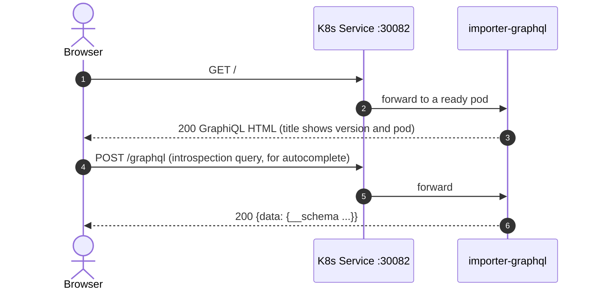

### POST /graphql (and POST /): shared steps

Every operation goes through these steps before its resolver runs. The diagrams below start at the resolver.

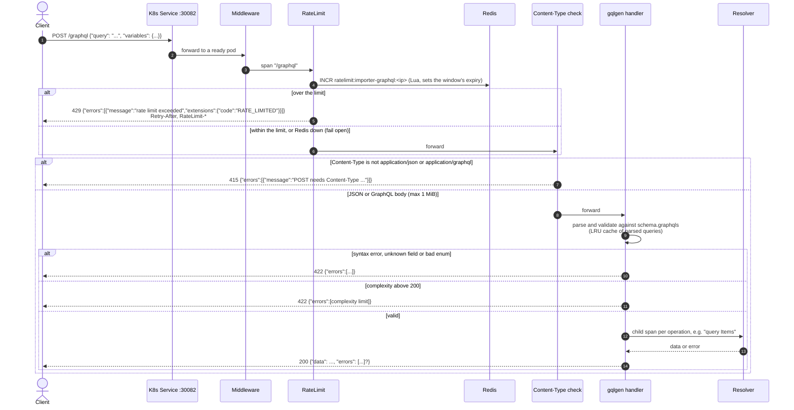

### query items

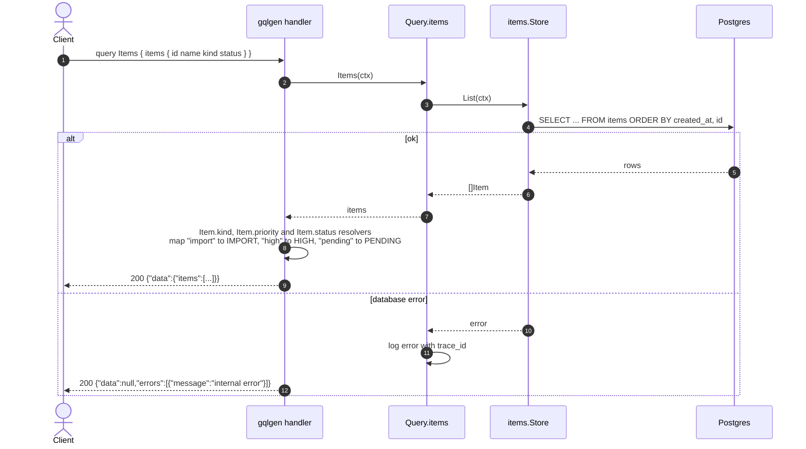

### query item(id)

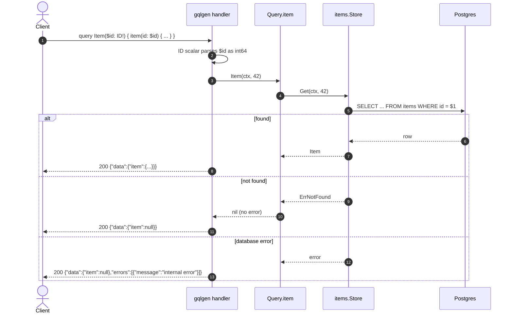

### mutation createItem

Same store call, so the same transaction and outbox as `POST /api/items`. importer-graphql runs its own outbox relay, and the rest of the asynchronous flow is the one shown under `POST /api/items`.

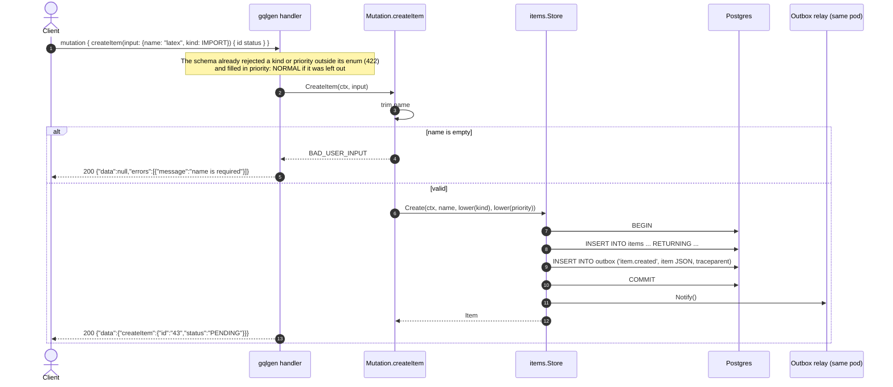

### mutation deleteItem

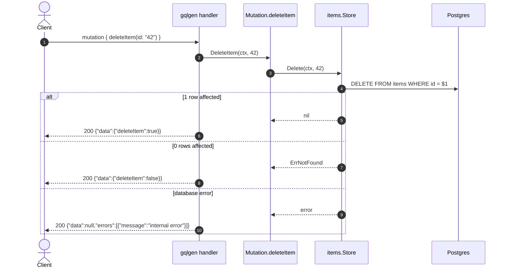
